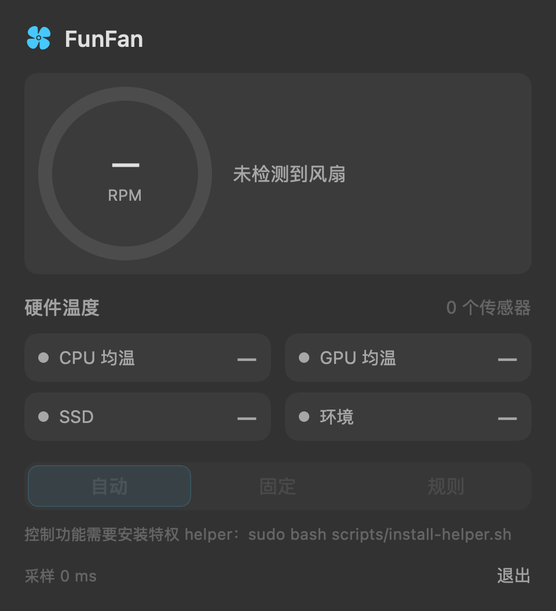
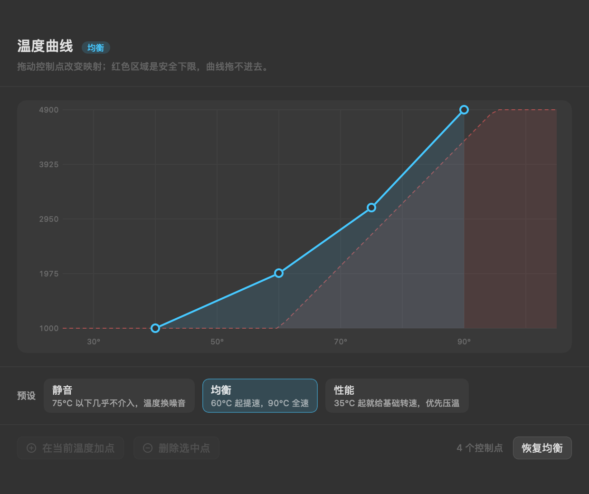
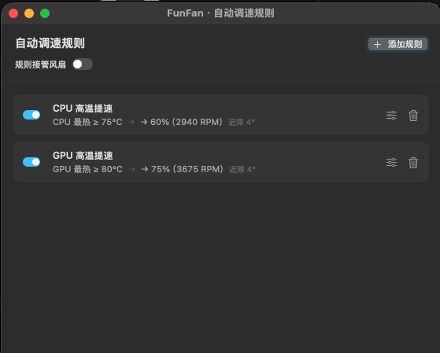
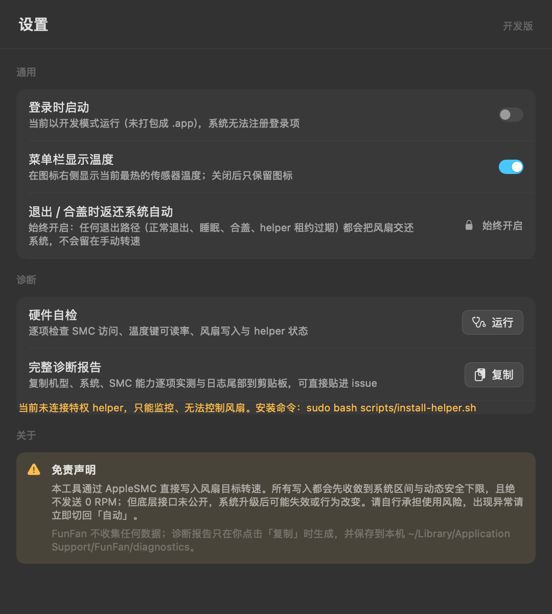

# FunFan

[](LICENSE)
[](https://github.com/lovexiaov/funfan/releases)
[](https://github.com/lovexiaov/funfan/actions/workflows/ci.yml)

macOS 菜单栏风扇控制工具，面向 **Apple Silicon**。零第三方依赖，纯 Swift / SwiftUI，用 SPM 构建。

不只是一个"拉滑块转风扇"的界面：它读 SMC 温度与电量，按你写的规则自动调速，并在任何异常路径上把控制权还给系统。

> **改风扇转速有风险。** 底层 SMC 接口未公开，系统升级后可能失效或行为改变。所有写入都会收敛到系统区间与安全下限、绝不发送 0 RPM，但请自行承担使用风险；出现异常先切回「自动」。

## 界面

| 菜单栏面板 | 温度曲线 |
|---|---|
|  |  |

| 规则自动调速 | 设置 |
|---|---|
|  |  |

## 现在能做什么

| 能力 | 说明 |
|---|---|
| 温度监控 | 全键枚举 `T*` 传感器（本机 180 个），按 CPU / GPU / 内存 / SSD / 电池 / 环境归类；CPU、GPU 同时给**均温**与**逐核 / 按簇**明细 |
| 电量监控 | 走 `IOPMPowerSource`（免 root、沙箱友好），台式机正确判定为"无电池" |
| 规则自动调速 | `CPU 均温 ≥ 60℃ → 3500 RPM` 这类规则，40 RPM 死区防抖、10 s 重断言、解除时只发一次命令 |
| 曲线调速 | 多控制点曲线 + 斜率限制，避免转速突跳 |
| 安全策略 | **只提速不压低**：60℃→最小值、95℃→最大值线性给出下限，任何策略结果都不能低于它；**绝不写 0 RPM**；多规则冲突取最大 |
| 租约看门狗 | GUI 经 XPC 让 root helper 持权，10 s 租约 + 1 s 看门狗；GUI 崩溃 / 退出 / 合盖，风扇自动回到系统控制 |
| 一键诊断 | 一条命令拿到可贴进 issue 的 Markdown 报告：机型、芯片、系统、SMC 键数、温度键可读率与不可读清单（含类型）、风扇区间与模式键、helper 状态与日志尾 |

## 安装（下载现成的包）

从 [Releases](https://github.com/lovexiaov/funfan/releases) 下载 `FunFan-<版本>.dmg`。

当前最新是 **`1.0.0-alpha.2`（预发布）**。alpha 的含义很具体：功能闭环，但合盖与第三方共存这两条路还没在真机上验过——发布说明与 `tasks/todo.md` 的 Verify 记录里写全了。不稳定就先别装，或者从源码构建。

> **这个包没有 Apple 签名证书，也没有经过公证。** FunFan 是个人项目，没有加入 Apple Developer Program（$99/年），产物是 adhoc 签名，macOS 会拦它一次，需要你手动放行。功能完全不受影响，代价只是首次启动多两步。信不过就往下看「从源码构建」，自己编出来的包不会有这道拦截。

**1. 校验（可选，但建议）**

三个附件都下载到同一个目录（通常是「下载」），在终端执行：

```bash
cd ~/Downloads && shasum -a 256 -c SHA256SUMS.txt
```

**2. 拖进「应用程序」**

双击 DMG，把 FunFan 拖到「应用程序」。**不要在 DMG 里直接运行**——从挂载的镜像里启动会走 App Translocation（随机只读路径），表现为弹「已损坏，无法打开」，而且后台组件会装不上。

**3. 放行一次**

双击 FunFan，会弹「Apple 无法验证「FunFan」是否包含恶意软件」。点**完成**（不要点「移到废纸篓」），然后：

```
系统设置 → 隐私与安全性 → 向下滚到「安全性」
→ 看到「FunFan 已被阻止以保护你的 Mac」→ 点「仍要打开」→ Touch ID 或密码确认
```

两个细节容易让人卡住：

- 「仍要打开」按钮只在**尝试打开后约 1 小时内**出现。窗口关了或者过了一小时，重新双击一次 App 让它再被拦一遍，按钮才会回来。
- macOS 15 起**右键 → 打开**这条老捷径已被 Apple 移除，网上大量教程还在教它，现在按了没有用。

不想走设置界面也可以直接清掉隔离属性（等价）：

```bash
xattr -dr com.apple.quarantine /Applications/FunFan.app
```

放行一次即长期有效。**升级到新版本后要再做一次**——每次下载都会重新带上隔离属性。

**4. 启用风扇控制**

菜单栏出现风扇图标 → 点开 → 面板底部「一键启用」→ 输入一次系统密码。之后升级 App 不用再授权，因为装的是一份独立的后台组件，不随 App 重装。

> 只看温度不装这个组件也能用。那份权限**只**用来写风扇转速。

## 从源码构建

需要 macOS 13+ 与 Xcode 命令行工具。自己编出来的包没有隔离属性，双击即开。

```bash
git clone https://github.com/lovexiaov/funfan.git
cd funfan

make build        # 调试构建（含 CLI / helper / probe / GUI）
make test         # 291 个单测
make run          # 启动菜单栏 App
```

只读功能（监控）**不需要 root**。写入风扇要先装一次特权后台组件——**在 App 里点一下就行**，不需要开终端：

```
打开 FunFan → 菜单栏面板底部「一键启用」     （或 设置 → 风扇控制组件 → 一键安装）
```

安装器会自己挑路线，两种都只打扰你一次：

| 情况 | 走哪条路 | 你会看到 |
|---|---|---|
| Developer ID 签名的正式包 | `SMAppService` 系统登记 | 系统设置里「允许」一次，之后随 App 升级不再问 |
| adhoc / 开发构建 / 已被脚本装过 | 管理员授权直装 `/Library/PrivilegedHelperTools` | 一次系统密码框 |

命令行等价物（开发期或排障用）：

```bash
make app && open dist/FunFan.app   # 装好后从 App 里点按钮
make install-helper                # 或脚本直装，每次都要 sudo
```

装完验证：

```bash
./.build/release/funfanctl doctor      # 确认硬件与权限
sudo ./.build/release/funfanctl spin --rpm 2950 --seconds 6   # 写入验证，结束自动返还
```

两种安装落在**同一个路径、同一个 label**（`cn.lovexiaov.fun.fan.helper`），所以彼此互斥；「一键安装」会自动 `bootout` 旧进程再覆盖，不需要先手动卸载。反过来，App 装过之后脚本会拒绝安装并说明原因（防止两个写手抢同一个 Mach service）。

### 清理改名前的残留

bundle id 从 `com.funfan.*` 迁到 `cn.lovexiaov.fun.fan` 之后，机器上的旧痕迹不会自己消失：旧 daemon 还注册着 `com.funfan.helper` 这个 Mach service，会和新 helper 同时写 SMC（风扇忽快忽慢、App 退出后不返还）。

```bash
bash scripts/purge-legacy.sh                  # 体检：只列出会清什么，不动手
sudo bash scripts/purge-legacy.sh --apply     # 真清（系统侧 + 用户侧）
```

默认保留 `~/Library/Application Support/FunFan`（规则 / 曲线 / 诊断报告）；要一并清掉加 `--with-user-data`，它是**移进废纸篓**而不是删除，随时能捞回。要从零重装验证加 `--incl-current`，连新 helper 一起卸。

## 命令行

```bash
make doctor      # 硬件与权限诊断（只读）
make diagnose    # 系统信息采集，输出 Markdown 报告
make status      # 当前风扇状态（只读）
make raw KEY=TR0Z   # 打印某键的原始字节与候选解码（未知 SMC 类型取证用）
make raw TYPE=ioft  # 按类型扫全表
```

`funfanctl` 支持 `diagnose [--json] [--save]`、`doctor`、`status`、`spin`、`set`、`restore`、`raw`。有失败项时 `diagnose` 退出码为 2，便于脚本化回归。

### 无人值守验收

GUI 支持几个调试启动参数，用来在没有人在屏幕前的情况下验证策略接管（`funfanctl status` 是唯一观测面）：

```bash
./.build/debug/FunFan --strategy curve              # 启动即进入曲线策略
./.build/debug/FunFan --strategy fixed --rpm 3000   # 固定转速
./.build/debug/FunFan --simulate-lid cycle          # 注入合盖→开盖往返
./.build/debug/FunFan --curve-window                # 直接开曲线编辑窗口
```

`--strategy` 会在 bootstrap 完成 1.5 s 后生效，并把决定打进日志。验证时配合 `funfanctl status` 看「目标 / 模式」是否变化；`kill -9` 掉 GUI 后约 10 s 应自动回到 `automatic`（helper 租约看门狗）。

`--simulate-lid` 是为**没有盖子的机器**准备的：合盖判定本身验不了，但「接管 → 合盖返还 → 挂起期间拒绝重新接管 → 开盖恢复」这条链可以。取值 `closed` / `open` / `cycle`（`cycle` = 3 s 后合盖、11 s 后开盖）。

## 打包与分发

SwiftPM 只产出裸可执行文件，而裸二进制**没有 bundle 标识**：`SMAppService`（登录项、特权 helper）一律注册失败，公证工具也没有东西可提交。所以分发形态必须先有 `.app`：

```bash
make app          # → dist/FunFan.app（内到外签名，默认 adhoc）
make run-app      # 打包并启动
make sign-info    # 看会自动选用哪个签名身份
```

包结构：

```
FunFan.app/Contents/
  Info.plist                              LSUIElement=true（菜单栏常驻、无 Dock 图标）
  MacOS/FunFan                            GUI
  MacOS/FunFanHelper                      特权 helper 本体
  Library/LaunchDaemons/cn.lovexiaov.fun.fan.helper.plist   给 SMAppService.daemon 用（BundleProgram 相对路径）
```

版本号唯一来源是仓库根的 `VERSION` 文件；`CFBundleVersion` 取 `git rev-list --count HEAD`，单调递增且可复现。

`--helper-status` / `--helper-install` / `--helper-uninstall` 是给验收与脚本用的（必须直接跑包内可执行文件，`open --args` 拿不到 stdout）：

```bash
dist/FunFan.app/Contents/MacOS/FunFan --helper-status     # 0 已可用 / 1 装了没生效 / 2 这个产物装不了
dist/FunFan.app/Contents/MacOS/FunFan --helper-install    # 需要授权时会在终端弹出密码框
```

状态输出把两套记账分开说：`SMAppService` 的系统登记状态，和直装到 `/Library/PrivilegedHelperTools` 的那份是否在、launchd 是否真在跑。混成一句会出现「系统未找到」但风扇明明能控的矛盾。

每一行都会同时写到 `~/Library/Application Support/FunFan/helper-cli.log`——用户报障时直接贴这一段，比「装不上」三个字有用得多。

签名身份的来源顺序：`--identity` 参数 → `FUNFAN_SIGN_IDENTITY` 环境变量 → 自动找 `Developer ID Application` → 回退 adhoc。**adhoc 签名进不了 Gatekeeper，也无法公证**，只够本机调试与开发登录项。

本项目**不打算购买 Developer ID 证书**，所以对外分发就是上「安装」一节描述的形态：adhoc 签名 + 用户手动放行一次。签名与公证的完整链路保留在下面，哪天有证书了直接可用，不需要改代码。

### 签名与公证（可选的付费路径）

> 没有证书也能发布，走的是 `--allow-unsigned` 内测包。这一节是把「万一以后买了证书」的路留住。

```bash
make notary-check    # 体检：证书 / 公证凭据 / 硬运行时 / 调试权限，缺什么说什么
make notarize        # 重建 .app → 打 DMG → 提交公证 → 装订 → Gatekeeper 验收
make dmg             # 只打 DMG（有证书就顺带签 DMG）
```

`make notarize` 的流程与它刻意拦在提交前的东西：

1. 用 Developer ID 重建并签名（内到外：先 helper 后 App，`--options runtime` 硬运行时）；
2. **提交前预检**——硬运行时缺失、带 `get-task-allow`、helper 签名不通过，全部在此拦下。公证一次往返通常 1–5 分钟，让它在第 0 秒失败比在第 5 分钟失败划算；
3. DMG 提交 `notarytool --wait`，非 `Accepted` 自动拉公证日志（`notarytool log`）；
4. `stapler` 装订票据，最后 `spctl` 验收——**Gatekeeper 真的放行才算过**，退出码 0 才有意义。

首次使用要准备两样东西（脚本只检查、不代办）：

```bash
# 1. Developer ID Application 证书：Xcode → Settings → Accounts → Manage Certificates → +
# 2. 公证凭据（App 专用密码，不是 Apple ID 密码）
xcrun notarytool store-credentials funfan-notary \
  --apple-id "you@example.com" --team-id "TEAMID" --password "app-specific-password"
```

凭据名可用 `FUNFAN_NOTARY_PROFILE` 覆盖。**本机当前没有 Developer ID 证书**，所以公证链路只完成了失败路径与预检逻辑的验证（`make notary-check` 会准确报出缺证书、缺凭据），实际签名/公证/装订要在装好证书的机器上跑一遍才算验完。

### 发到 GitHub Release

本项目**没有 Developer ID 证书**，所以对外发的就是未公证内测包：

```bash
make publish-dry         # 演练：单测 → 打包 → 打印将执行的 gh 命令，不建 release
make publish-unsigned    # 真发：单测 → 打包 → DMG + ZIP + SHA256SUMS → 草稿 release
```

`make publish`（不带 `--allow-unsigned`）走的是签名 + 公证的正式链路，没有证书时会**直接退出 2 并告诉你缺什么**——这是刻意的，免得哪天手滑把一个别人装不上的包发出去。

版本号取自 `VERSION`，tag 为 `v<版本>`；默认建**草稿**，在网页上核对完附件再点 Publish（`--publish` 直接公开）。附件三件套分别是给人下载的 DMG、给自动更新器的 zip、给校验用的 `SHA256SUMS.txt`。

未公证的包，release notes 里会自动插入解除隔离属性的命令，内容是「安装」一节的简版——用户从 Release 页面点进来就能看到该怎么做，不必回头翻 README。详见 [docs/RELEASE.md](docs/RELEASE.md)。

### 推 tag 自动打包（GitHub Actions）

不想占本机时间，或者手上不是开发机时，把 tag 推上去就够了：

```bash
echo 1.0.0-alpha.2 > VERSION && git commit -am "版本号 1.0.0-alpha.2"
git tag -a v1.0.0-alpha.2 -m "FunFan 1.0.0-alpha.2" && git push origin v1.0.0-alpha.2
```

`.github/workflows/release.yml` 会在 GitHub 的 macOS 机器上跑：单测 → 组 `.app` → DMG → ZIP → `SHA256SUMS.txt` → 校验产物结构 → **建草稿 Release** 并挂上三个附件。`VERSION` 与 tag 不一致会直接失败，不会糊里糊涂发出去。

> CI 里没有证书，出的同样是 **adhoc 未公证包**，和 `make publish-unsigned` 一个性质。哪天买了证书，把证书与 notarytool 凭据放进 Secrets，再把工作流里「组包」那步换成 `bash scripts/notarize.sh` 就能出已公证的包。

两条路选一条跑，别都跑：本机 `make publish-unsigned` 会自己建 release 再推 tag，CI 到的时候会看见 release 已有完整附件，于是**只做编译验证、不上传覆盖**——用 CI 的包换掉你验过的包，等于悄悄换了用户下载的东西。

Release notes 的文案在 `scripts/gen-release-notes.sh`，本机脚本和 CI 都调它，所以两边说的一定是同一套话；想手写就放 `release-notes/v<版本>.md`，CI 会优先用它。

## 代码结构

```
FunFanCore/     硬件与逻辑（无 UI 依赖，可单测）
  SMC/          AppleSMC 访问（80 字节结构体）、编解码、键枚举
  Monitor/      传感器目录、采样与平滑、采样频率策略
  Battery/      电量与电池明细
  Control/      安全策略、曲线、规则引擎、控制器、租约、第三方接管检测
  Helper/       特权组件的签名要求与注册状态（纯数据，可单测）
  Rules/        规则持久化（原子写、损坏降级）
  XPC/          与 helper 的契约
  System/       机型/合盖判定、签名信息
  Diagnostics/  能力探测与诊断报告
  Types/        错误类型等公共定义
FunFan/         SwiftUI 菜单栏 App
FunFanCtl/      CLI（funfanctl）
FunFanHelper/   特权 helper（XPC + 看门狗）
FunFanProbe/    真机探针
Tests/          291 个单测
```

## 几个真机上踩到的坑

这些都是实测才知道的，不是文档里查得到的：

- `SMCParamStruct` 必须严格 **80 字节**。Swift 里 `struct` 的内存对齐会让它变成 76 或 84，调用静默失败。项目里用逐字段 offset 断言钉死。
- Apple Silicon 上温度并非全是 `flt`。本机 180 个温度键里有 6 个是 **`ioft`**（8 字节小端 48.16 定点），且必须**按有符号解**——未接探针会返回高位全 1 的哨兵值，按无符号解会得到 2.8e14℃，反而"看起来合法"地骗过合理性过滤。
- `swift build` 直接产出的二进制只有 **linker-signed** 签名，`launchd` 装载时会报 `Bootstrap failed: 5`。安装脚本里会重新 `codesign --force --sign -`。
- 本机 SPM 的 `sandbox-exec` 受限，所有 `swift` 命令都得带 `--disable-sandbox`（Makefile 已统一处理）。
- 合盖状态的 `AppleClamshellState` 在现代 macOS 上已不存在，改用「内建屏是否在线 + 是否有外接屏在线」双条件判定。

## 安全边界

- 绝不写 `F0Mn` / `F0Mx`（固件推荐区间），只写 `F0Tg`。
- 目标转速一律 clamp 到系统区间，**绝不发送 0 RPM**。
- 任何退出路径（正常退出、崩溃、合盖、helper 侧租约过期）都会返还系统自动控制。
- 规则只能"提速"。你自己的规则不可能把风扇降到安全下限以下。

## 文档

| 文件 | 内容 |
|---|---|
| [docs/macos-fan-control-research.md](docs/macos-fan-control-research.md) | 调研：SMC 协议、权限模型、开源方案对比、推荐路径 |
| [docs/SPEC-FunFan.md](docs/SPEC-FunFan.md) | 规格：范围、架构、模块职责、验收标准 |
| [docs/RELEASE.md](docs/RELEASE.md) | 发布手册：证书准备、出包步骤、人工验收清单、常见失败处理 |
| [docs/ui-design-handoff.md](docs/ui-design-handoff.md) | UI 设计交付稿（含实现偏差附录） |
| [docs/ui-prototype/funfan-design.html](docs/ui-prototype/funfan-design.html) | 可交互 HTML 原型 |
| [tasks/todo.md](tasks/todo.md) | 任务清单与逐项验证记录 |
| [CONTRIBUTING.md](CONTRIBUTING.md) | 贡献流程、代码约定、fork 前必须改的 bundle id |
| [SECURITY.md](SECURITY.md) | 信任模型与私密漏洞上报渠道 |
| [CODE_OF_CONDUCT.md](CODE_OF_CONDUCT.md) | 社区行为准则 |

## 状态

M1（SMC 地基）→ M5（GUI）已完成并在真机（Mac mini M4 / macOS 27）验证：180/180 温度键可读、风扇 1000–4900 RPM 写入生效、291 个单测全绿。

策略四态（自动 / 固定 / 曲线 / 规则）全部可用，曲线与规则编辑器均已落地；设置窗口支持登录启动、菜单栏显示开关、一键自检与免责声明。

曲线策略已在真机跑通端到端：接管后 `manualFixed`、目标随温度单调跟随（2116→2333）、实际转速误差 0–3 RPM、`kill -9` 后 8 s 由租约看门狗返还 `automatic`。规则策略的写入链路与曲线共用同一套下发路径。

M6（打包加固）已落地：`.app` 打包、Developer ID 签名 + 公证 + 装订脚本、helper 一次授权（`SMAppService`）、第三方接管检测与 `doctor` 自检。公证链路只验到失败路径与提交前预检；打包后的 helper 注册还差一次真机复验（见 `tasks/todo.md` M6 的 Verify 记录）。

**分发形态：未签名、未公证。** 已决定不购买 Apple Developer Program 会员（$99/年），对外发的就是 adhoc 签名的内测包，用户按「安装」一节手动放行一次。签名 + 公证的脚本留在仓库里，将来有证书可以直接启用，不需要改代码。这个选择的代价很具体：每个下载的人多两步点击，而且每次升级都要重复。

已发布：[`v1.0.0-alpha.2`](https://github.com/lovexiaov/funfan/releases/tag/v1.0.0-alpha.2)（标为 prerelease，不进 Latest；更早的 `v1.0.0-alpha.1` 仍在）。附件 `dmg` / `zip` / `SHA256SUMS.txt`，tag 指向构建它的那个提交。

未完成：T16b 端到端合盖验证（需笔记本机型）。

## 许可

[MIT](LICENSE)。用、改、分发、商用都可以，保留版权与许可声明即可，不提供任何担保。

改风扇转速属于对硬件的直接操作，风险自负；详见上面的风险提示与 [`SECURITY.md`](SECURITY.md) 里的信任模型。

## 参与贡献

欢迎 issue 与 PR：

- 功能异常 / 安装问题 → 按 [issue 模板](https://github.com/lovexiaov/funfan/issues/new/choose) 提交，附上诊断报告
- 安全问题 → 走私密渠道，见 [`SECURITY.md`](SECURITY.md)
- 代码贡献 → 先读 [`CONTRIBUTING.md`](CONTRIBUTING.md)，**fork 构建前务必改 bundle id**，否则会和本机已装的 helper 抢同一个 launchd label
